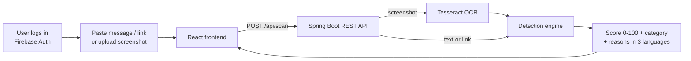

[README.md](https://github.com/user-attachments/files/35116124/README.md)
<div align="center">

# 🛡️ ScamShield AI

**Check it before you reply.** A scam and phishing detector that gives every message, link and screenshot an explainable 0–100 risk score, in English, Hinglish and Hindi.


[Live Demo](#-live-demo) · [Features](#-features) · [How it works](#-how-it-works) · [Getting started](#-getting-started) · [API](#-api)

</div>

---

## 🌐 Live Demo

| | Link |
|---|------|
| **App (frontend, Vercel)** | https://scamshield-frontend-drab.vercel.app |
| **API (backend, Render)** | https://scamshield-backend-ck8n.onrender.com |

Open the app, create an account, paste a suspicious message or link, and press **Check for scam**.

> The backend runs on a free tier, so the first request after a break can take 30–50 seconds while the server wakes up.

---

## 🎯 The problem

Every day, people in India get SMS and WhatsApp messages like *"Your KYC has expired, update now or your account will be blocked"* or *"Earn ₹5000 per day from home."* Most people cannot tell a real message from a fake one in the moment, and one wrong tap can empty a bank account.

**ScamShield AI** turns that doubt into a clear answer. Paste a message, a link or a screenshot, and get:

- a **risk score from 0 to 100**,
- the **type of scam** (phishing, KYC fraud, job scam, parcel scam),
- the **reasons behind the score**, written in simple English, Hinglish or Hindi.

---

## ✨ Features

| Feature | What it does |
|---------|--------------|
| **Three ways to scan** | Paste a message, paste a link, or upload a screenshot (text is read with OCR). |
| **Explainable risk score** | A 0–100 score with a plain list of reasons, so the user knows *why*. |
| **Scam categories** | Phishing, KYC fraud, job scam and parcel scam. |
| **3 languages** | Explanations in English, Hinglish and Hindi, switchable in one tap. |
| **Login** | Email and Google sign-in with Firebase Authentication. |
| **Scan history** | Reopen your recent checks any time. |
| **PDF report** | Save any result as a PDF. |
| **Share on WhatsApp** | Send the result to family or friends in one tap. |
| **Scam guide + helpline** | Short guides on common scams and the **1930** cyber crime helpline. |

---

## ⚙️ How it works



### Detection engine

The backend checks the text against weighted rules and adds up a score (capped at 100).

**Message signals**

| Category | Example signals | Weight |
|----------|-----------------|--------|
| KYC fraud | "update your KYC", Aadhaar, PAN, "account will be blocked" | 35 |
| Job scam | "work from home", "per day", "registration fee" | 35 |
| Parcel scam | courier, customs, "delivery failed", "redelivery" | 30 |
| Phishing | "verify your account", password, OTP, "click here", urgent | 30 |

**Link signals**

| Signal | Weight |
|--------|--------|
| Raw IP address instead of a website name | 35 |
| Domain ending often used by scammers (`.xyz`, `.top`, `.click`, ...) | 30 |
| Link is `http` and not `https` | 20 |
| Shortened link (`bit.ly`, `tinyurl`, ...) | 20 |
| Odd characters used to imitate real sites | 20 |

**Risk levels:** `0–34` looks safe · `35–69` suspicious · `70–100` high risk.

Every rule carries its explanation in English, Hinglish and Hindi, so the same response works for all three languages.

---

## 🧰 Tech stack

| Layer | Technology |
|-------|------------|
| Backend | Java, Spring Boot, REST API |
| OCR | Tesseract OCR |
| Frontend | React, Vite, CSS |
| Auth | Firebase Authentication (Email + Google) |
| Hosting | Vercel (frontend), Render (backend) |
| Tools | Git, GitHub, VS Code, Postman |

---

## 📁 Project structure

```
scamshield-backend/
├── src/main/java/com/scamshield/backend/
│   ├── BackendApplication.java   # entry point
│   ├── ScanController.java       # POST /api/scan (text, link, image)
│   ├── Detector.java             # scoring rules + 3-language reasons
│   └── CorsConfig.java           # allows the frontend to call the API
└── src/main/resources/application.properties

scamshield-frontend/
├── src/
│   ├── Root.jsx      # shows login or app
│   ├── Login.jsx     # email + Google login
│   ├── App.jsx       # scanner, result, history, scam guide
│   ├── api.js        # talks to the backend
│   ├── firebase.js   # Firebase setup
│   └── styles.css
└── index.html
```

---

## 🚀 Getting started

> Just want to try it? Skip the setup and open the [live app](https://scamshield-frontend-drab.vercel.app).

### Prerequisites

- Java 21 or newer
- Node.js 20 or newer
- [Tesseract OCR](https://github.com/UB-Mannheim/tesseract/wiki) (only needed for screenshot scanning)
- A free [Firebase](https://console.firebase.google.com) project with Email/Password and Google sign-in turned on

### 1. Run the backend

```bash
git clone https://github.com/tanishkaj538/<your-backend-repo>.git
cd <your-backend-repo>
./mvnw spring-boot:run        # Windows: .\mvnw spring-boot:run
```

The API starts on `http://localhost:8080`. Open it in the browser to check:
`{"status":"ScamShield API is running"}`

### 2. Run the frontend

```bash
git clone https://github.com/tanishkaj538/<your-frontend-repo>.git
cd <your-frontend-repo>
npm install
```

Create a `.env` file in the project root:

```env
VITE_API_URL=http://localhost:8080
VITE_FIREBASE_API_KEY=your_api_key
VITE_FIREBASE_AUTH_DOMAIN=your_project.firebaseapp.com
VITE_FIREBASE_PROJECT_ID=your_project_id
VITE_FIREBASE_APP_ID=your_app_id
```

Then start it:

```bash
npm run dev
```

Open `http://localhost:5173`.

> Without a `.env`, the app still runs in **demo mode** using a built-in detector, so you can try the interface without a backend.

---

## 🔌 API

### `POST /api/scan`

**Message or link** (JSON)

```json
{
  "type": "text",
  "content": "Your KYC is expired. Update now: http://sbi-kyc-update.xyz/login"
}
```

`type` is `"text"` or `"url"`.

**Screenshot** (`multipart/form-data`): send the image in a field named `file`.

**Response**

```json
{
  "score": 100,
  "category": "kyc",
  "reasons": {
    "en": ["Asks you to update KYC or ID details under threat of blocking.", "..."],
    "hinglish": ["KYC ya ID update karne ko kaha hai aur account block hone ki dhamki di hai.", "..."],
    "hi": ["KYC या ID अपडेट करने को कहा गया है और अकाउंट ब्लॉक होने की धमकी दी गई है।", "..."]
  }
}
```

**Errors** return `{ "detail": "message" }` with status `400` (empty input), `422` (no text found in image) or `503` (OCR not available).

---

## 🧗 Design decisions and challenges

- **Explainable on purpose.** A bare "scam: yes/no" is not useful. Each rule has a weight and a written reason, so the result teaches the user what to look for next time.
- **Three languages from one response.** The API returns reasons for English, Hinglish and Hindi together, so switching language in the UI needs no extra request.
- **Frontend and backend on different ports.** The browser blocks calls between `localhost:5173` and `localhost:8080`, so the backend has an explicit CORS configuration.
- **Large screenshots.** Spring Boot allows only 1 MB uploads by default, which is too small for phone screenshots, so the limit is raised to 10 MB.
- **Works without a backend.** The frontend falls back to a built-in detector when no API URL is set, which makes the UI easy to demo and test.

---

## 🛣️ Roadmap

- [ ] Train an ML classifier (scikit-learn) to work alongside the rules
- [ ] Save scan history per user in Firestore
- [ ] Containerize with Docker and Docker Compose
- [ ] More scam categories (loan apps, lottery, UPI refund)
- [ ] Browser extension and WhatsApp bot

---

## ⚠️ Disclaimer

ScamShield AI is a helper, not a guarantee. When in doubt, do not click, do not reply, and never share an OTP. If you have lost money, call the National Cyber Crime Helpline **1930** and report at [cybercrime.gov.in](https://cybercrime.gov.in).

---

## 👩‍💻 Author

**Tanishka Jain**
B.Tech CSE (AI), MIET Meerut

[LinkedIn](https://www.linkedin.com/in/tanishka-jain-b1b648345) · [GitHub](https://github.com/tanishkaj538)

⭐ If this project helped you, consider giving it a star.
